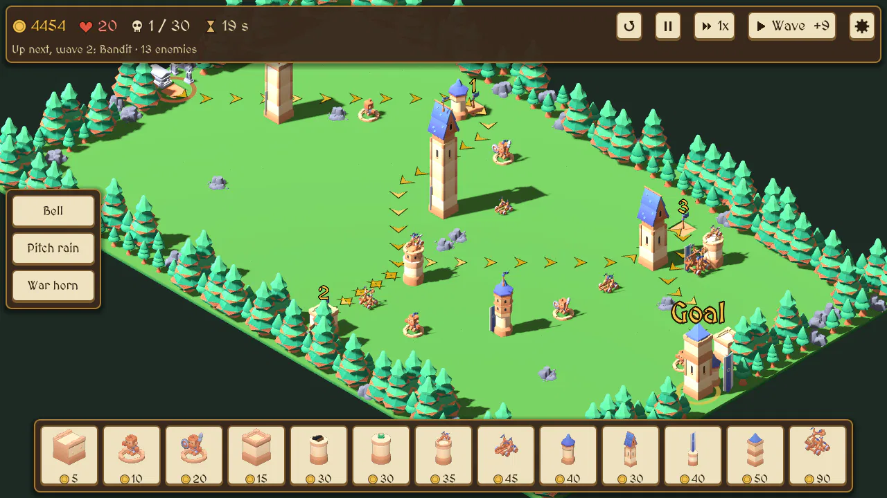
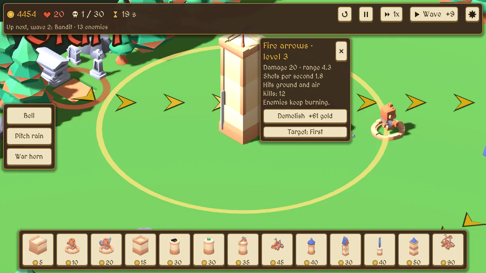
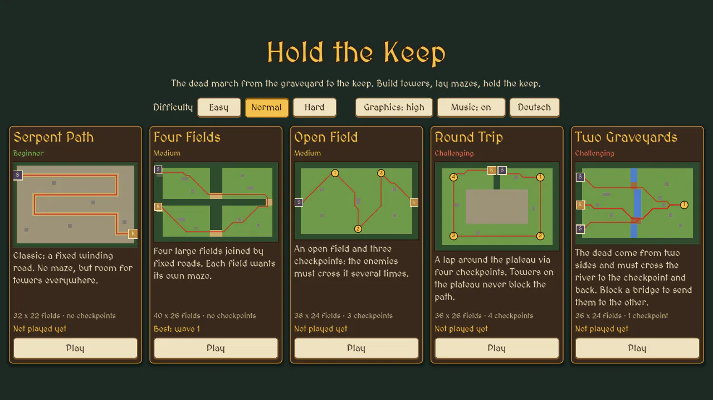
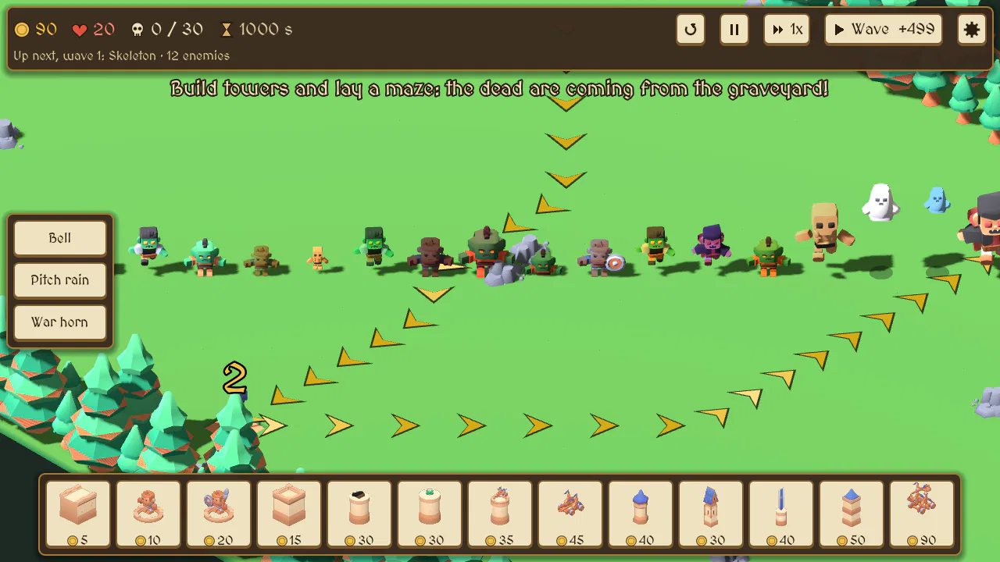

<div align="center">

# 🏰 Hold the Keep

**An isometric medieval tower defense game. Build towers, lay out mazes and hold the keep against 30 waves of the undead.**

[](https://github.com/aikitori/hold-the-keep/actions/workflows/pages.yml)
[](https://github.com/aikitori/hold-the-keep/releases)


[](LICENSE)

[**▶ Play in the browser**](https://aikitori.github.io/hold-the-keep/) · [**Download APK**](https://github.com/aikitori/hold-the-keep/releases)

[](https://apps.obtainium.imranr.dev/redirect?r=obtainium://add/https://github.com/aikitori/hold-the-keep)
<br><sub>In Obtainium, turn on <i>Include prereleases</i>, the alpha versions are published as prereleases.</sub>

 
 

</div>

In the spirit of the classic Warcraft III tower defense maps: the dead march from the graveyard to your keep,
and you stand in their way with archers, catapults, mages and walls. On open ground you place your towers so
the enemies have to walk the long way round, past everything you've built. Free and open source, no ads, no
tracking.

> **Alpha:** playable from the first to the last wave, but balance and content are still changing.

## Features

- **Maze building:** towers on grass block the way, and the enemies take the shortest path that is left. Make
  it as long as you like, but never block it completely. A preview shows the new path before you build.
- **13 towers:** from 5-gold walls to the trebuchet, from single-target ballistae to splash damage, slowing
  magic, poison that ignores armor, anti-air, a war banner that boosts nearby towers and a toll house for income.
- **Upgrades and specialisations:** three levels per tower, and on level 3 a choice between two
  specialisations, e.g. *Frost mage* or *Lightning mage*.
- **Target priority per tower:** first, strongest, weakest or flyers first. No wasted shots: towers skip
  enemies that are already doomed.
- **17 enemy types and 2 bosses:** armored knights, healing ghouls, burrowing gravers, shield bearers, berserkers, plague
  zombies, necromancers who summon skeletons, and flyers that ignore your maze. A vampire or gravedigger boss
  every five waves.
- **3 abilities:** *Bell* (slow everything), *Pitch rain* (area damage) and *War horn* (double fire rate).
- **5 maps, 3 difficulties:** endless mode after wave 30 and a best score for each map and difficulty.
- **Made for touch and mouse:** the interface scales up on phones and tablets, in portrait and landscape,
  keyboard shortcuts on the desktop, rotatable camera, game speed and pause.
- **Saves between waves:** close the game and continue later.
- English and German.

## Maps

| Map | Level | Idea |
|---|---|---|
| Serpent Path | Beginner | A fixed winding road. No maze, but room for towers everywhere |
| Four Fields | Medium | Four large fields joined by fixed roads, each wants its own maze |
| Open Field | Medium | One open field, three checkpoints make the enemies cross it several times |
| Round Trip | Challenging | A lap around a plateau via four checkpoints |
| Two Graveyards | Challenging | Enemies from two sides, a river with two bridges. Block one to send them to the other |

## How to play

1. Pick a difficulty and a map.
2. Choose a tower in the build bar and click a grass tile. Hold <kbd>Shift</kbd> to keep building, or drag
   across several tiles to build a row of walls. On touch the first tap shows a preview, the second builds.
3. Tap a tower to upgrade, specialise or demolish it, tap an enemy to see its traits.
4. The top bar shows what the next wave brings. **Wave +N** calls it early for N bonus gold.

Each defeated wave pays 5 % interest on your gold (up to 25). Demolishing returns 70 %, or everything while
the tower hasn't fired yet in the build phase it was placed in.

<details>
<summary><b>Towers</b></summary>

| Tower | Gold | Hits | Specialisations |
|---|---|---|---|
| Wall | 5 | – | – (blocks only) |
| Bowman | 10 | ground + air | Longbow · Volley |
| Spearman | 20 | ground | Knight · Pikeman |
| Archer tower | 15 | ground + air | Fire arrows · Volley tower |
| Bombard | 30 | ground | Culverin · Grapeshot |
| Poison kitchen | 30 | ground + air | Plague cauldron · Black death |
| Ballista | 35 | ground | Giant bolt · Sky ballista |
| Catapult | 45 | ground | Fire pots · Stone hail |
| Mage tower | 40 | ground + air | Frost mage · Lightning mage |
| Sky watch | 30 | air | Storm tower · Eagle's nest |
| War banner | 40 | – | Warlord · Great banner |
| Toll house | 50 | – | Treasury · Bounty |
| Trebuchet | 90 | ground | Devastation · Precision |

</details>

<details>
<summary><b>Controls</b></summary>

| Action | Keyboard and mouse | Touch |
|---|---|---|
| Move the map | right or middle drag, <kbd>WASD</kbd>, arrow keys, screen edge | drag with one finger |
| Zoom | mouse wheel, <kbd>+</kbd> <kbd>-</kbd> | pinch |
| Rotate | <kbd>Q</kbd> <kbd>E</kbd> | twist with two fingers |
| Back to the keep | <kbd>Home</kbd>, <kbd>H</kbd> | – |
| Choose a tower | <kbd>1</kbd> – <kbd>0</kbd>, <kbd>Shift</kbd>+<kbd>1</kbd> – <kbd>3</kbd> | tap in the build bar |
| Abilities | <kbd>Z</kbd> <kbd>X</kbd> <kbd>C</kbd> (by key position, <kbd>Y</kbd> <kbd>X</kbd> <kbd>C</kbd> on QWERTZ) | buttons on the left |
| Upgrade, target, demolish | <kbd>U</kbd>, <kbd>T</kbd>, <kbd>Del</kbd> or <kbd>Backspace</kbd> | tower card |
| Next wave, speed, pause | <kbd>Space</kbd>, <kbd>F</kbd>, <kbd>P</kbd> | buttons at the top |
| Cancel | right click, <kbd>Esc</kbd> | cancel button, Android back |

</details>

All rules and values are in [docs/GAME_DESIGN.md](docs/GAME_DESIGN.md) (German).

## Development

```
scripts/       game code (GDScript): board and pathfinding, towers, enemies, HUD, camera; all values in defs.gd
scenes/        menu, game, and dev scenes for tests, balance bot and screenshots
assets/        models, sounds, music, font, app icon
tools/         Godot installer, Android build, asset import, music generator
docs/          game design document and screenshots
```

You need [Godot](https://godotengine.org) 4.7.2 (standard build, not .NET). `tools/install_godot.sh` installs
it with the Android export templates. The project uses the Compatibility renderer, so it runs on Android and in
the browser.

```sh
godot --headless --import                              # once after cloning
godot res://scenes/menu.tscn                           # play
godot --headless res://scenes/dev/logic_test.tscn      # tests: expect "LOGIC-TEST OK"
godot --headless res://scenes/dev/balance.tscn -- weites_feld normal   # a bot plays 30 waves
godot --headless res://scenes/dev/dps.tscn             # damage per second and per gold of each tower
```

The map ids are `schlangenpfad`, `vier_felder`, `weites_feld`, `rundlauf` and `zwei_friedhoefe`.
`tools/build_android.sh` builds a debug APK (needs JDK 17 and the Android SDK). Pushing a tag `alpha-X.Y.Z`
tests the game, builds the APK and publishes a prerelease. Every push to `main` deploys the web version.

## Contributing

Bug reports, ideas and pull requests are welcome. Please read [CLAUDE.md](CLAUDE.md) first, it explains the
code layout and the pitfalls. In short: code comments and commit messages are in German, every UI text goes
through `tr()` with an English translation in `scripts/lang.gd`, the logic test must pass, and new features
are described in [docs/GAME_DESIGN.md](docs/GAME_DESIGN.md).

## License

Code: [GPL v3 or later](LICENSE). Copyright (C) 2026 aikitori.

- 3D models by [Kenney](https://kenney.nl) (CC0): Tower Defense Kit, Castle Kit, Mini Dungeon, Graveyard Kit.
- Font: MedievalSharp by wmk69 (SIL Open Font License).
- Sound effects and jingles (CC0) by Kenney and by rubberduck on OpenGameArt, sources in `tools/import_sfx.py`.
- Music generated by `tools/make_music.py`.

License texts: `assets/models/*/License.txt` and `assets/fonts/OFL.txt`.
